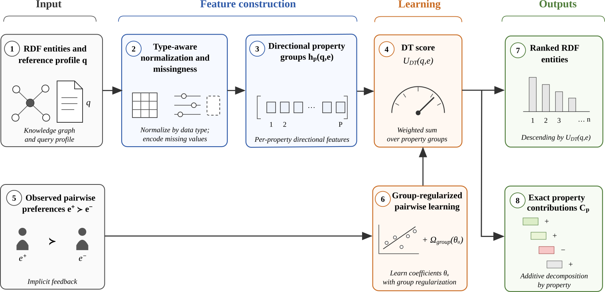

# Directional typed learning to rank (DT-LTR)

DT-LTR learns to rank entities described by numerical, ordinal, categorical
and set-valued properties. It compares each candidate with a reference profile,
constructs a feature group for each property, and learns an additive utility
from observed preferences. The resulting score gives both a ranking and an
exact decomposition into named property contributions.

This repository contains the implementation and experiments for **Directional
typed learning to rank for heterogeneous RDF entities**, evaluated on vehicle
preferences and a validated RDF catalogue.

## Method pipeline



*Pipeline reused from Figure 1 of the paper.*

| Stage in the figure | What the method does |
|---|---|
| **Input** | Read entity descriptions, a reference profile `q`, and preference observations. A declared registry identifies the properties and their analytical types. |
| **Feature construction** | Normalise values, retain missingness and construct reference-relative property groups. Numerical and ordinal groups distinguish deviations below and above the reference; categorical and set groups represent matching and overlap. |
| **Learning** | Fit coefficients from pairwise preferences or choices within a set. The additive utility combines the weighted property groups; optional support adaptation personalises the population coefficients. |
| **Outputs** | Rank candidates by decreasing utility. Property contributions sum exactly to the score, and their differences reconstruct a pairwise ranking margin. |

The vehicle experiments use archival ANU pairwise preferences, McFadden--Train
choice sets, and generated noisy comparisons over the bundled ADEME catalogue.
Matched symmetric, direct, spline and CatBoost controls assess the contribution
of the representation. Generated preferences are controlled mechanism tests.

Training, development selection, probability calibration and test evaluation
use separate data roles. Any session adaptation uses only that session's
reserved support choices. The [experiment protocol](study/EXPERIMENT_PROTOCOL.md)
and [reproducibility guide](docs/REPRODUCIBILITY.md) give the full design and
interpretation limits.

## Install and check

Use Python **3.12** and [uv](https://docs.astral.sh/uv/). A GPU is not required.
Run these commands from this folder in a Linux shell or Windows PowerShell;
the same commands work in both:

```sh
uv sync --frozen --extra dev
uv run --frozen --extra dev python scripts/verify_release.py
uv run --frozen --extra dev python scripts/demo.py
uv run --frozen --extra dev python -m pytest -q
```

The verifier checks the fixed release inventory. The demo fits and inspects a
small artificial example; its labels are not research evidence. The locked
environment uses `uv.lock`, which pins direct and transitive dependencies.
The recorded validation scope is in `VALIDATION.json`.

## First experiment: bundled data only

```sh
uv run --frozen --extra dev python -u scripts/run_experiment.py run --config configs/smoke.yaml --suite audit --suite generated --output runs/generated-smoke --workers 2
```

This runs **three tasks**: the RDF registry audit and two generated mechanisms.
All eight representations are evaluated in the generated tasks. No human-data
download is needed. Smoke runs check execution on small samples.

## Archival and full experiments

Read [data sources and terms](data/README.md). Acquisition is an explicit opt-in:

```sh
uv run --frozen --extra dev python scripts/acquire_data.py --dataset all --download
uv run --frozen --extra dev python -u scripts/run_experiment.py run --config configs/smoke.yaml --output runs/all-smoke --workers 2
uv run --frozen --extra dev python -u scripts/run_experiment.py run --config configs/pilot.yaml --output runs/pilot --workers 4
uv run --frozen --extra dev python -u scripts/run_experiment.py run --config configs/full.yaml --output runs/full --workers 4
```

The full profile contains **101 tasks** without an external observed-data bundle
and is much more expensive than smoke. `configs/ablation-smoke.yaml` provides a
small repeated check across all completion/clipping policies; run it with the
same command and a new output such as `runs/ablation-smoke`. The four profiles
are separate studies, with their settings declared in the configuration files.
The runner itself never downloads data.

## Plan, resume and inspect

`plan` verifies inputs and saves a run manifest without fitting. Use a separate
directory for a preview:

```sh
uv run --frozen --extra dev python scripts/run_experiment.py plan --config configs/full.yaml --output runs/full-plan
```

To execute that exact planned run, use `run` with the same configuration and
output plus `--resume`. To resume an interrupted run:

```sh
uv run --frozen --extra dev python -u scripts/run_experiment.py run --config configs/full.yaml --output runs/full --workers 4 --resume
uv run --frozen --extra dev python scripts/run_experiment.py summarize --output runs/full
uv run --frozen --extra dev python scripts/run_experiment.py export --output runs/full
```

Resume requires unchanged code, configuration, data and runtime; a changed
identity requires a new output directory. `summarize` can inspect a partial run;
`export` requires completion. Reports appear under `reports/`: `REPORT.md`,
numerical CSVs, `fits.json` and `diagnostics.json`. Full task records and
predictions remain under `tasks/`. Export writes a compact archive and checksum
under `exports/`, omitting the full task files. Reports and exports can contain
session-level model information and locally acquired provenance; review them
before sharing.

The active implementation is `src/dtltr_vehicle/experiments/`, importable as
`dtltr_vehicle.experiments`. See [reproducibility](docs/REPRODUCIBILITY.md) and
the [frozen numerical reference](reference_results/README.md) for provenance
and interpretation.

## Package the release

```sh
uv run --frozen --extra dev python scripts/package_release.py --output ../dtltr-code.zip
```

The packager verifies `RELEASE_MANIFEST.json` and includes only its named files,
the manifest and `SHA256SUMS`. Virtual environments, acquired archives, runs and
caches are excluded. An existing ZIP is not overwritten.

See the [software licence](LICENSE), [third-party notices](THIRD_PARTY_NOTICES.md)
and `CITATION.cff`. Add actual deposit metadata when the artifact is published.
